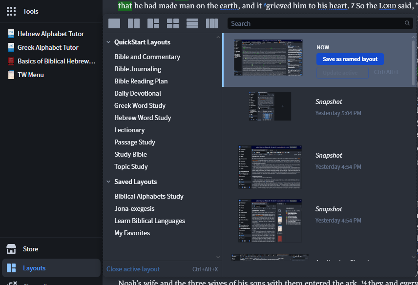

*Written from Faithlife's help pages for Logos version 55 (November 2026). Points marked "checked in the app" were tried in Logos 55 on 24 Nov 2026.*

## Panels and tabs

Every book or tool you open appears in a **panel**. A panel can hold several books as **tabs**: click a tab to bring that book to the front. Drag a tab to another part of the window to move it into a different panel, or to make a new one (checked in the app).

## Tile Arrangements

The buttons across the top of the **Layouts** menu are **Tile Arrangements**. There are six in the desktop app (checked in the app). Each one rearranges the panels you already have open into a set pattern. A Tile Arrangement does not open or close any book. It only moves what is open.

## Layouts and snapshots

A **layout** is a saved set of open books and tools, with their panels and tabs. Instead of opening your Bible, a commentary and a dictionary one by one each day, you open one layout.

Logos also keeps **snapshots** by itself: records of how your screen looked at a given time. When you close Logos, it saves a snapshot, and it keeps up to ten. A snapshot is not a named layout until you save it as one.

## The Layouts menu

Click **Layouts** on the main toolbar. The menu has three parts:

- **At the top:** the Tile Arrangements and a Find box.
- **On the left:** the **QuickStart Layouts** and your **Saved Layouts**.
- **On the right:** your snapshots, newest first. The top one, marked **Now**, is your screen as it is now (checked in the app).

*Screenshot: Copyright Logos ([logos.com](https://www.logos.com)). Not covered by this site's licence.*

## Start with a QuickStart Layout

QuickStart Layouts are ready-made layouts for common tasks. Trying a few is a quick way to see what Logos can put on one screen. A good first one is **Bible and Commentary**. It opens your top Bible and the commentary that best matches it, set to move together. Others include **Passage Study**, **Greek Word Study**, **Hebrew Word Study** and **Topic Study**.

## Save your own layout

1. Open your books and tools, and arrange them.
2. Open the **Layouts** menu.
3. On the current snapshot at the top right, click **Save as named layout**.
4. Type a name, for example "Mark" or "Exegesis".

It now appears under **Saved Layouts**. Click it there to open it again.

## Change a saved layout

- To keep changes to the layout you are using, click **Update Active** on the current snapshot. The shortcut is Ctrl+Alt+L (Windows) or Cmd+Alt+L (Mac).
- Right-click a saved layout to **Load**, **Rename** or **Delete** it.
- **Close active layout** (Ctrl+Alt+X) is at the bottom of the menu (checked in the app).
- You can also change a QuickStart Layout: right-click it and choose **Replace with current layout**. **Restore default layout** undoes this.

## Open a layout quickly

- **Toolbar:** drag a layout from the Layouts menu onto the shortcuts area of the main toolbar. One click then opens it.
- **At startup:** in Program Settings, **At Startup Open to** can open your most recent layout.

## Ideas for your own layouts

These are suggestions, not Faithlife instructions.

- **A layout for each Bible book.** Not every commentary or handbook covers every book, and you may prefer different ones for different books. Make a "Jonah" or a "Mark" layout with the Bible, handbook, commentary and notes you use for that book.
- **A layout for each task.** For example an **Exegesis** layout (original-language text, Exegetical Guide, a lexicon), or a **Textual criticism** layout (a Greek New Testament with its apparatus and a textual commentary).

## Good to know

Layouts do not sync to the Logos mobile app.
