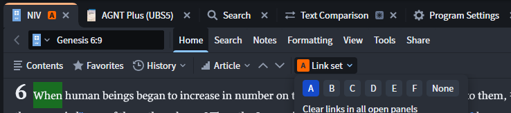

*Written from Faithlife's help pages for Logos version 55 (November 2026). Not yet checked in the app.*

## What a link set is

Panels in the same **link set** move together. When you go to Mark 1 in your Bible, a commentary in the same link set goes to Mark 1 too. Link sets are named by letters, A, B, C and so on.

This is the quickest way to read a passage in two translations side by side, or a passage with its commentary.

## Link two books

1. Open both books, for example a Bible and a commentary on the whole Bible.
2. In the first book, click **Link Set** on the **Home** tab and choose a letter.
3. In the second book, choose the **same** letter.

*Screenshot: Copyright Logos ([logos.com](https://www.logos.com)). Not covered by this site's licence.*

Now move in either book and watch the other follow.

## Make a tool follow your Bible

Some tools and guides have no dynamic toolbar.

1. Click in the book the tool should follow.
2. Open the tool's **More Actions** menu (three dots).
3. Choose **Follow**.

## What you can link

- Two or more Bibles
- A Bible with a commentary. In a commentary set with many volumes, Logos changes volume when you change Bible book.
- A Bible with a lexicon. Clicking a word opens its entry.
- A Bible with the Passage Guide, Exegetical Guide or Bible Word Study

Some of these need a Bible in Greek or Hebrew, or an English Bible linked word by word to the Greek or Hebrew (a reverse interlinear).

## Remove links

- **One book:** **Link Set** › **None**.
- **Everything:** **Clear links in all open panels**.

## Keep your links

Links are lost when you close the panel or Logos. To keep them, save the layout (see [Layouts](~/guides/layouts/)). The **Bible and Commentary** QuickStart Layout comes already linked.
