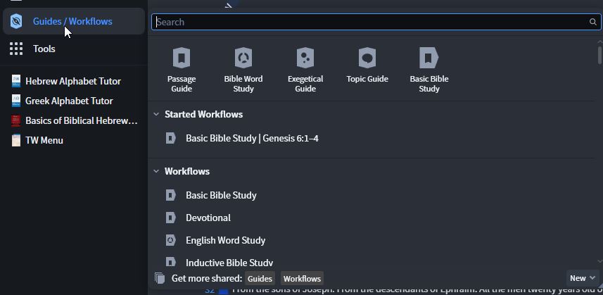
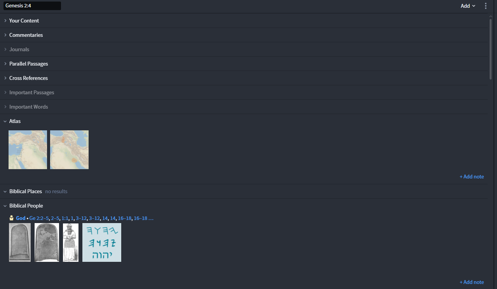

*Written from Faithlife's help pages for Logos version 55 (November 2026). Points marked “in the app checked for this guide” were tried in Logos 55 on 24 Nov 2026.*

## What it is

A **guide** is a report that Logos builds from your library. The **Passage Guide** gives a broad overview of one passage. Its sections can include:

- **Commentaries** on the passage
- **Cross References**
- **Systematic and Biblical Theologies**
- **Biblical People**, places, things and events
- **Media Resources**, such as maps and pictures
- **Topics** and **Sermons**

For a close look at the Greek or Hebrew words, use the [Exegetical Guide](~/guides/exegetical-guide/) instead.

## Open it

- **Guides menu:** click **Guides / Workflows**, then **Passage Guide**. Type the passage and press Enter.
- **Right-click:** select the passage in a Bible and right-click. In the left pane, choose the reference. On the right, click **Passage Guide**.
- **Selection Menu:** select the passage, then click **Study**.

*Screenshot: Copyright Logos ([logos.com](https://www.logos.com)). Not covered by this site's licence.*

In the app checked for this guide, typing “Passage Guide” in the Command Box did not find it. Open it from the **Guides / Workflows** menu.

*Screenshot: Copyright Logos ([logos.com](https://www.logos.com)). Not covered by this site's licence.*

## Shape it to your work

All guides work in the same way:

- **Collapse** a section: click the triangle beside its heading.
- **Remove** a section: point at its heading and click the **X**.
- **Add** a section: click **Add** at the top right of the guide.
- **Move** a section: drag it.
- **Section options:** point at a heading and open **Settings**.

Logos remembers your changes. The next Passage Guide you open has the same sections in the same order.

## Why your guide may look different

What you see depends on your Logos plan and on the books in your library. A colleague with a different plan, or with Translator's Workplace books, may see other sections and other results. If a section you expect is missing, try **Add**.

## On other devices

The Passage Guide is complete in the desktop app. The web app and the mobile app have a smaller version, and the mobile one needs the internet.
