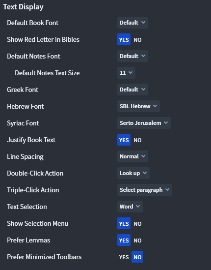
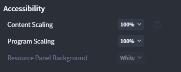
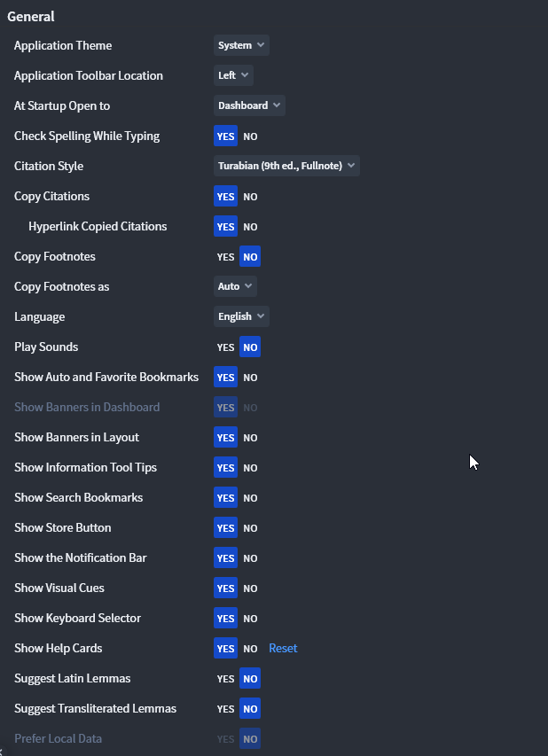
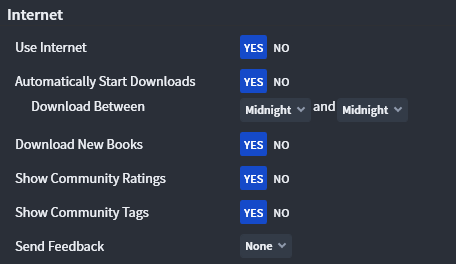

*Written from Faithlife's help pages for Logos version 55 (November 2026) and checked against the Program Settings screens in the app on 24 Nov 2026.*

## Open Program Settings

Click the **More Actions** menu (three dots) on the main toolbar, then **Program Settings**.

These settings apply to Logos as a whole, not to one book or tool. Most are Yes/No switches. A change takes effect at once and there is no Save button. A few changes, such as the program language, need a restart.

For help on any setting, point just to the right of it and then at the **?** icon that appears.

The settings are in sections. The **Internet** section has its own guide: [Internet and download settings](~/guides/internet-settings/).

## Text Display

How text looks in your books (but not its size: see Accessibility below).

*Screenshot: Copyright Logos ([logos.com](https://www.logos.com)). Not covered by this site's licence.*

- **Default Book Font**, and separate **Greek Font**, **Hebrew Font** and **Syriac Font**. Choose a Hebrew or Greek font you read easily.
- **Line Spacing** and **Justify Book Text** change the layout of the text.
- **Double-Click Action** and **Triple-Click Action** decide what happens when you double-click or triple-click a word: **Look up**, **Search**, **Search Inline** or select the word.
- **Show Selection Menu** shows or hides the small menu that appears when you select text.
- **Prefer Lemmas** decides what Logos uses when you look up or search a word in a reverse interlinear Bible: the Greek or Hebrew word under it (**Yes**) or the English word (**No**).
- **Prefer Minimized Toolbars** keeps each book's toolbar folded away until you open it.

## Accessibility

*Screenshot: Copyright Logos ([logos.com](https://www.logos.com)). Not covered by this site's licence.*

- **Content Scaling** changes the size of the text in **all** books. Make it larger if the text is hard to read.
- **Program Scaling** changes the size of text, buttons and menus in the **whole program**. Make it smaller to fit more on a small screen.
- **Resource Panel Background** changes the background colour behind the text of your books.

To change the text size of **one** book only, open it and use **Zoom** on its **View** tab.

## General

*Screenshot: Copyright Logos ([logos.com](https://www.logos.com)). Not covered by this site's licence.*

- **Application Theme:** the colours of Logos. **System** follows your computer's light or dark setting.
- **Application Toolbar Location:** the main toolbar on the **left** or at the **top** of the window. This setting needs a Logos Premium subscription or higher.
- **At Startup Open to:** what you see when Logos starts: the Dashboard, a blank layout, or one of your layouts (see [Layouts](~/guides/layouts/)).
- **Citation Style:** the style Logos uses for citations, for example Turabian or APA.
- **Language:** the language of the menus and screens, not of your books. Restart Logos after you change it.
- **Show Keyboard Selector** shows a button for switching to a Greek or Hebrew keyboard.
- **Show Help Cards** shows short help the first few times you open a panel. **Reset** starts them again.

## Internet

*Screenshot: Copyright Logos ([logos.com](https://www.logos.com)). Not covered by this site's licence.*

**Use Internet**, **Automatically Start Downloads**, **Download Between** and **Download New Books** control when Logos goes online and downloads. See [Internet and download settings](~/guides/internet-settings/).

Program updates arrive with automatic downloads, or you type `update now` in the **Command Box**.
