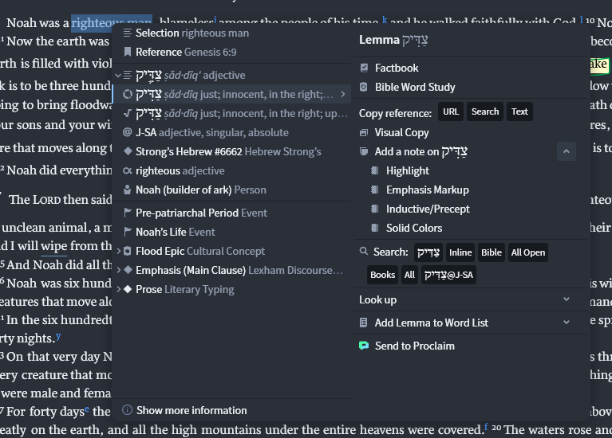
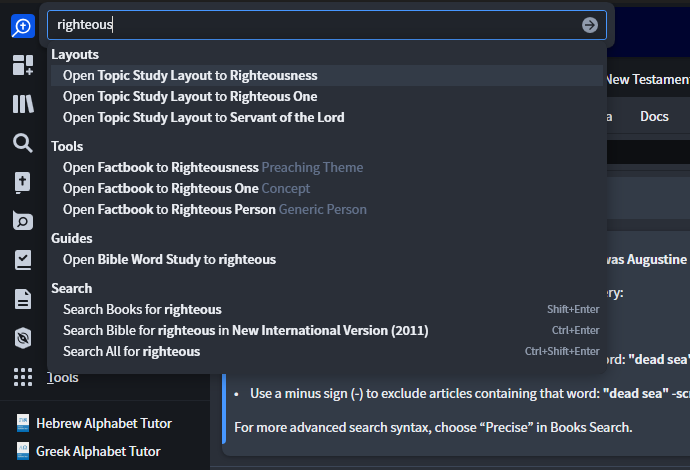
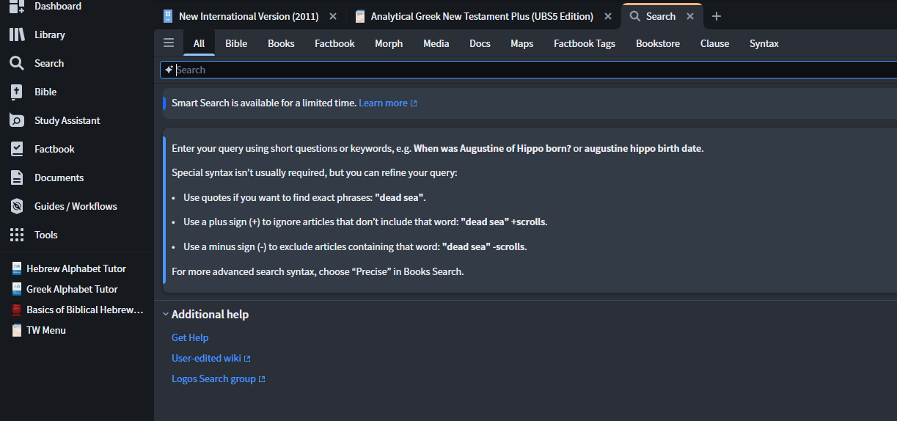

*Written from Faithlife's help pages for Logos version 55 (November 2026). Points marked “checked in the app” or “seen in the app” were tried in Logos 55 on 24 Nov 2026.*

## Three places to start

### 1. Right-click a word

Right-click a word in a Bible. The left side of the **Context Menu** lists what you clicked: the selection, the reference, and, in a tagged Bible, the Greek or Hebrew word (lemma), its grammar, its Strong's number and its sense. Choose one. The right side then lists what you can do with it, including **Search** in this book, in your Bibles, in your other books or everywhere (seen in the app).

What you see depends on the book and on your Logos package.

*Screenshot: Copyright Logos ([logos.com](https://www.logos.com)). Not covered by this site's licence. Bible text: NIV.*

### 2. The Command Box

Type a word in the **Command Box** at the top of the toolbar. Logos lists layouts, tools, guides and searches that match (checked in the app). From the box:

- Ctrl+Enter searches your Top Bible for the word (Windows).
- Ctrl+Shift+Enter searches everything, **All** (Windows).

*Screenshot: Copyright Logos ([logos.com](https://www.logos.com)). Not covered by this site's licence.*

### 3. The Search tool

For a search you control fully, open the Search tool. The rest of this guide is about it.

## Open Search

Click the **Search** icon on the toolbar, or press Alt+S (Windows). The tabs are the **search types**. They choose what you search. The main ones are:

- **All:** everything at once.
- **Bible:** your Bibles.
- **Books:** your other books.

There are others, such as **Factbook** and **Media**. Which tabs you see depends on your Logos plan. **Morph** search (by Greek or Hebrew grammar) needs a higher plan.

*Screenshot: Copyright Logos ([logos.com](https://www.logos.com)). Not covered by this site's licence.*

## Smart or Precise

- **Smart** search takes a question in plain words and uses AI to find answers. The help pages disagree on whether it needs a subscription.
- **Precise** search finds exactly the words you type.

Logos switches to Precise by itself when you use quotation marks or search words such as AND, or when you type only Greek or Hebrew. For translation work, Precise is usually what you want.

## Search the Bible for exact words

1. Open Search and choose **Bible**.
2. Set the switch to **Precise**.
3. Choose which Bibles to search. Logos starts with your Top Bible.
4. To search part of the Bible, click **All Passages** and type a range, for example `Matthew-John`.
5. Type your words and press Enter.

Results can be shown in several ways, for example as a list of passages, or as a **Grid** that lines up the results from several Bibles.

## Search your other books

Choose **Books**. To narrow the search, click **Your Books** and choose one book, a collection or a series.

## Search words to know

These words must be in **capital letters**.

| Type | Finds |
|---|---|
| `"son of man"` | the exact phrase |
| `grace AND peace` | both words |
| `grace OR mercy` | either word |
| `love NOT God` | the first word without the second |
| `love*` | love, loved, loving, lovely… |
| `spirit NEAR water` | the two words close together |

Use brackets to group words, for example `(grace OR mercy) AND peace`.

## Look it up: Power Lookup

**Power Lookup** is not a search, but it saves many searches. Faithlife lists it under **Tools** › **Lookup**.

- **Compare lexicons:** right-click a word in your Bible, choose the lemma on the left, then **Power Lookup** on the right. You see a part of the entry from each lexicon in your library, one after the other. Click a short title to open that lexicon.
- **Compare dictionaries:** right-click an English word, choose **Selection**, then **Power Lookup**. You see your dictionary entries for the word.
- **Read the links in a book:** open **Tools** › **Lookup** › **Power Lookup** while a book is open. As you scroll, it shows the text of the Bible references and footnotes the book links to.

You can copy, print or export what Power Lookup shows.
