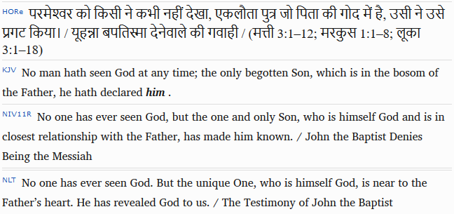

## What you need

- **In Paratext:** a **text collection** with your regional-language Bible (the Bible in your language of wider communication, or LWC) and a few English Bibles. The Paratext manual suggests ordering them from more literal to less literal.
- **In Logos:** the same idea in **Text Comparison**. See the Logos guide [Text Comparison](../../../../logos/guides/text-comparison/).

## John 1:18 in four Bibles

*Screenshot from Paratext. Bible text: Hindi Old Version (re-edited), KJV, NIV, NLT; one verse each, quoted for teaching. Not covered by this site's licence.*

The Hindi Old Version says **एकलौता पुत्र**, “the only Son”, and so does the KJV (“the only begotten Son”). The NIV and the NLT both say this one **is himself God**. The NIV also says “Son”, but only to make “the one and only” clear in English. So the test is: does the Bible call him “God” here? The Bibles disagree about who has made the Father known: “the only Son” or “the only God”.

## The six steps at this level

1. **Find the problem.** The Bibles differ in meaning: is he called “God” or only “Son”? That is worth a closer look.
2. **List the readings.** You can list what each Bible says. You cannot yet see which Greek manuscripts stand behind each one.
3. **External evidence.** Not visible here. A Bible does not tell you which manuscripts it follows.
4. **Internal evidence.** Not visible here either.
5. **Weigh it up.** You can only see that the Bibles are split.
6. **Decide.** Not yet. But notice: **if you simply follow the Hindi Bible, you have already decided for “Son”**, the reading of the Textus Receptus (the printed Greek text behind the KJV and many older Bibles). Most Indian-language Bibles checked so far stand mainly on the Textus Receptus side.

## Textual or translation difference?

Not every difference between Bibles comes from the Greek text. At John 3:16 the KJV says “his only begotten Son” and the NIV says “his one and only Son”. Both translate the same Greek words. That is a translation difference. “Son” and “God” are different Greek words. That is a **textual** difference, and it is the kind this series is about.

## What this level can tell you

| Can tell you | Cannot tell you |
|---|---|
| That the Bibles differ, and how | Why they differ |
| Which reading your readers know | Which reading is older |
| Where a hidden decision is waiting | What to decide |

## When to go one step deeper

When the Bibles differ in **meaning**, go on to [Part 2: Translation helps](~/learn/decisions/translation-helps/). They explain what is happening in the Greek.

## Decide with your team

The decision is made with your Review Committee, following your text policy. See the [decision tree](~/learn/decisions/#dtn-textual-decision--decide) and [Which text should a translation follow?](~/guide/text-policy/).
