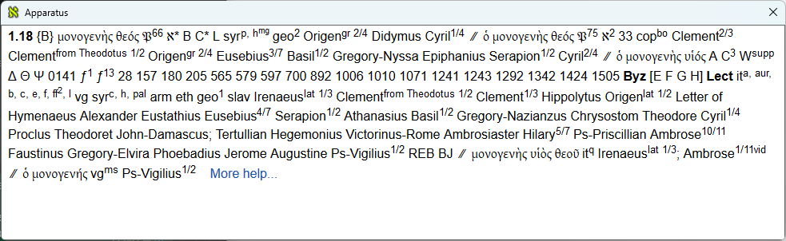

## What you need

- **The UBS Greek New Testament apparatus.** In Paratext it opens beside the Greek text.
- **A textual commentary.** Metzger's *Textual Commentary* explains why the UBS committee chose each reading. Omanson's *Textual Guide* says the same more simply, for translators.
- This site's guide [Reading the apparatus](~/guide/apparatus/), which takes the John 1:18 entry apart piece by piece.

## John 1:18 in the apparatus

*Screenshot from Paratext: the UBS Greek New Testament, 5th edition, apparatus. Quoted for teaching. Not covered by this site's licence.*

The entry starts with the rating **\{B\}**, then lists the readings, separated by //:

| Reading | Meaning | Some witnesses |
|---|---|---|
| μονογενὴς θεός (the UBS text) | “only God” | 𝔓⁶⁶, א*, B, C*, L |
| ὁ μονογενὴς θεός | “the only God” | 𝔓⁷⁵, א², 33 |
| ὁ μονογενὴς υἱός | “the only Son” | A, C³, Θ, Ψ, Byz, most Latin |
| μονογενὴς υἱὸς θεοῦ | “only Son of God” | one Old Latin manuscript, Irenaeus (Latin) |
| ὁ μονογενής | “the only one” | a Vulgate manuscript |

The first two readings differ only by the Greek article ὁ (“the”). In English both are “the only God”, and both count as the reading “God”.

Byz means the Byzantine manuscripts: the large group of later Greek manuscripts. To read every siglum (the short sign for a manuscript, such as B or 𝔓⁶⁶) and every mark, see [Reading the apparatus](~/guide/apparatus/).

## What the rating tells you

\{B\} means the text is **almost certain**, as the UBS editors put it. It is the committee's opinion, not a measure of the evidence. At John 1:18 the decision was a majority, and one member wrote that at least \{D\} would be better. See [Which variants matter](~/guide/which-variants-matter/) for what the ratings do and do not tell you.

The decision tree says: for \{A\} or \{B\}, follow the UBS text, **but** if a Bible your readers use follows another reading, study it. The Hindi Old Version reads “Son”, so John 1:18 needs study even with a \{B\}.

## The six steps at this level

1. **Find the problem.** The apparatus marks it with a rating.
2. **List the readings.** All the readings the editors judged important, with their witnesses.
3. **External evidence.** You can now judge it yourself: which witnesses are old, where they come from, how many.
4. **Internal evidence.** The textual commentary gives the committee's reasons.
5. **Weigh it up.** Compare your view with the committee's.
6. **Decide.** You can explain the evidence to your Review Committee.

## What this level can tell you

| Can tell you | Cannot tell you |
|---|---|
| Every reading the editors judged important for translators | The wording of each manuscript in full |
| The witnesses for each, and the committee's confidence | Whether a manuscript has other relevant changes nearby |
| The committee's reasons (in the commentary) | Your own reading of the manuscripts |

## When to go one step deeper

When the evidence is close, or your team wants to see the manuscripts themselves, go on to [Part 5: Full textual criticism](~/learn/decisions/full-textual-criticism/).

## Decide with your team

The decision is made with your Review Committee, following your text policy. See the [decision tree](~/learn/decisions/#dtn-textual-decision--decide) and [Which text should a translation follow?](~/guide/text-policy/).
