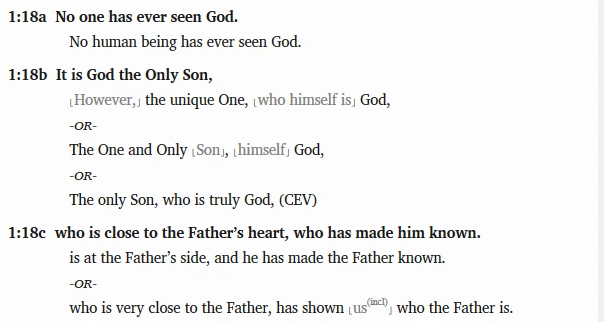
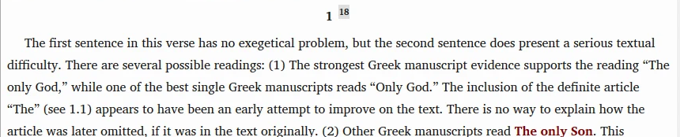

## What you need

In Paratext, open these resources beside your project at the verse:

- **TNN, the Translator's Notes.** Written for translators who speak English as a second language. They explain the meaning of the text in detail, point out what is hard to translate, and give other translators' ideas.
- **TND, the Display.** Each verse part as a **source line** from a published Bible, then one or more plain **meaning lines**.
- **HBKENG, the UBS Handbook Series.** A verse-by-verse handbook for translators. At a textual problem it usually lists the readings and says which one the UBS committee chose.

## John 1:18 in the helps

### The Display (TND)

*Screenshot from Paratext: Translator's Notes, Display (SIL). A short excerpt, quoted for teaching. Not covered by this site's licence.*

The Display gives three ways to say 1:18b, each saying that this one **is himself God**: “the unique One, who himself is God”, “the One and Only Son, himself God”, and “the only Son, who is truly God” (from the CEV). So it follows the reading “God”. Remember the Display's own advice: do not translate a meaning line word for word. Think how to say the meaning in your language.

### The UBS Handbook (HBKENG)

*Screenshot from Paratext: UBS Handbook Series (United Bible Societies). A short excerpt, quoted for teaching. Not covered by this site's licence.*

In its own words, the Handbook:

- says the first sentence of the verse is easy, but the second has a serious textual problem;
- lists the readings: “the only God” (the strongest Greek support), “the only Son” (an easier reading, perhaps made to match John 3:16 and 3:18), “God's only Son”, and “the only one”;
- follows the UBS committee, and suggests ways to say “the only God” so that readers understand it, with a model from another English Bible.

## The six steps at this level

1. **Find the problem.** The Handbook names it for you.
2. **List the readings.** The Handbook lists them, with the main manuscripts in general terms.
3. **External evidence.** Summarised for you: which reading has the strongest manuscript support.
4. **Internal evidence.** Also summarised: which reading is easier, and how a scribe might have changed it.
5. **Weigh it up.** The helps weigh it for you and say which reading they follow.
6. **Decide.** You can follow their recommendation, but you are trusting their judgement.

## What this level can tell you

| Can tell you | Cannot tell you |
|---|---|
| What the problem is, in plain English | The full evidence |
| Which reading the helps recommend, and why | Whether you would weigh it the same way |
| Ways to say the meaning in another language | Which manuscripts are behind each reading, in detail |

## When to go one step deeper

When the helps disagree with your regional-language Bible, and your Review Committee will want to see the evidence, go on to [Part 3: The NET notes](~/learn/decisions/net-notes/).

## Decide with your team

The decision is made with your Review Committee, following your text policy. See the [decision tree](~/learn/decisions/#dtn-textual-decision--decide) and [Which text should a translation follow?](~/guide/text-policy/).
